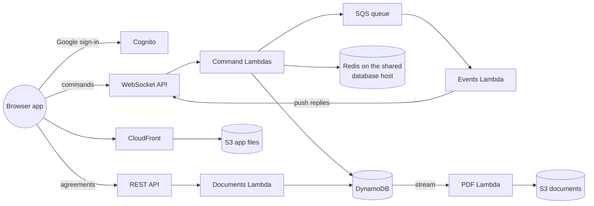

# RENTracker

> This repository publishes the documentation of a private codebase; a script or source
> file the documents name is not here.

A rental tracking app for landlords and the people who rent from them. A landlord lists
apartments, fills in a rental agreement, and sends the renter a link; the renter signs in, adds
their details and attachments, and signs on the phone. The app renders the signed agreement as a
PDF, emails both sides, and keeps a log of each apartment's activity, such as payments sent and
accepted. Every landlord runs a space of their own inside one shared deployment, so the app is a
small SaaS rather than one landlord's tool.

**Contents:** [Overview](#overview) · [Tech stack](#tech-stack) · [Architecture](#architecture) ·
[Getting started](#getting-started) · [Scripts](#scripts) · [Details](#details)

## Overview

- **Sign-in and roles**: a user signs in with a Google account and, on the first visit, picks a
  role: landlord or renter. A landlord becomes a customer of the service without help and gets a
  space of their own; in this app a "SaaS tenant" is such a landlord customer, never a person
  renting an apartment.
- **Apartments**: a landlord adds apartments (address, unit, rooms, monthly rent) and can
  disable one.
- **Rental agreements**: a landlord fills in an agreement for an apartment: property and
  included equipment, lease terms, utility limits, the landlord's details, and optional
  guarantees and a guarantor. The form checks Israeli ID and phone numbers and the order of the
  lease dates.
- **Signing**: the landlord shares the agreement's link, for example on WhatsApp. The renter
  who opens it signs in, completes the renter's details, uploads an ID card and pay slips, and
  draws a signature; the landlord then signs too.
- **PDF and email**: every save renders the agreement as a PDF from a Hebrew template. Both
  sides get an email about it, and either can download the PDF. Email reaches only an address
  that confirmed the verification email AWS sends on a user's first sign-in.
- **Activity log and live updates**: each apartment keeps a log, such as "Payment sent for
  05/2025", and an entry can wait for the other side's confirmation. A change a user makes
  reaches that user's other open sessions without a reload.
- **Operator and languages**: the operator signs in as the admin, a Google account fixed when
  the app is deployed, sees every landlord account and can disable one, and never manages a
  landlord's apartments, agreements or renters. The interface follows the browser's language,
  Hebrew or English, and fits a phone screen.

## Tech stack

- **Frontend** — React 18 with TypeScript, Redux and Material UI, built with Create React App,
  served from S3 behind CloudFront
- **Backend** — Node.js 24 Lambdas behind an API Gateway WebSocket API and a REST API, with their
  shared code in Lambda layers
- **Data** — DynamoDB tables, an S3 bucket for agreements and attachments behind its own
  CloudFront distribution, and Redis on the account's shared database host
- **Messaging** — an SQS queue that carries replies to the browsers, an EventBridge bus that
  receives every change for other services to subscribe to, SES for email
- **Documents** — Markdown templates rendered to PDF with `marked` and headless Chromium
  (`puppeteer-core` with `@sparticuz/chromium`)
- **Auth** — Google as the only sign-in, through a Cognito user pool another stack owns
- **Infrastructure** — one AWS SAM template deployed by bash scripts; CloudWatch logs and X-Ray
  tracing

## Architecture

The browser keeps a WebSocket open: each command wakes a Lambda that reads or writes DynamoDB
through a Redis cache, and a second Lambda pushes the reply back to the browsers through an SQS
queue. Agreements go through a REST API, and every change to one starts a Lambda that renders its
PDF into S3. All landlords share the same functions and tables; every item carries its
landlord's user id, and the data layer makes each write conditional on it.

**[Architecture](docs/architecture.md)** continues from here: the full diagram, every function,
queue and table, the cross-cutting mechanisms and the codebase layout.

## Getting started

You need the AWS CLI, the AWS SAM CLI, `jq`, `git`, and Node.js 24 with `npm`. The stack deploys
beside resources the account already runs, which `scripts/lib/stack-params.sh` names; a deploy
into another account starts by pointing those values at equivalents there:
- the Cognito user pool of the `vsdb-cognito` stack, with Google set up as its sign-in provider
  (a fresh account starts there: [Sign-in](docs/sign-in.md#setting-up-google));
- Lambda layers published by the `vsdb-lambda-layers` and `sum` stacks, and this repo's own
  layers, each published once and pinned to its version number;
- Redis on the account's shared database host, an EC2 instance that serves databases to several
  apps of the account, reached by its public name with a password.

1. Run `./scripts/init-env.sh`, which creates `aws-config.sh`, `secrets.sh` and `params.sh`
   under `scripts/lib/` from their `.example.sh` files, and fill in the AWS credentials and
   region, the Redis password and the mail sender address. The files are gitignored, and the
   scripts refuse to load one git would track.
2. Run `./scripts/test.sh` to check the scripts and lint the template; the backend has no
   automated test suite.
3. Run `./scripts/deploy.sh --frontend`. It builds and deploys the stack, then builds the React
   app, uploads it and prints its CloudFront address. The git branch selects the stack: `main`
   deploys `rntrk`, any other branch `rntrk-fb`.
4. For local frontend work, run `npm start` in `frontend/`; every deploy leaves
   `frontend/src/appConfig.json` pointing at the branch's stack with a `http://localhost:3000`
   sign-in redirect, which the stack's Cognito app client allows.

[Development & deployment](docs/development.md) has the details.

## Scripts

- `init-env.sh` — creates the gitignored settings files under `scripts/lib/` from their
  `.example.sh` files
- `test.sh` — the quality gate: `bash -n` on every script and the SAM lint check
- `deploy.sh` — lints, builds and deploys the branch's stack; `--frontend` also publishes the
  React app, `--frontend-only` only that, `--sync` runs `sam sync` on a feature branch's stack
- `aws-helper.sh` — every other AWS operation on the stack: function list and logs, log
  retention, X-Ray, stack deletion, the region's leftover resources and unused layer versions

Each script's header comment is its full documentation, and `--help` prints it.

## Details

- [Architecture](docs/architecture.md) — what each part is for, how the parts talk, the data
  model and the codebase
- [Development & deployment](docs/development.md) — the settings files, the tests, the
  scripts, what the stack expects in the account, and the layers
- [Sign-in](docs/sign-in.md) — how Google sign-in reaches the APIs through the shared pool, and
  its setup in a new account
