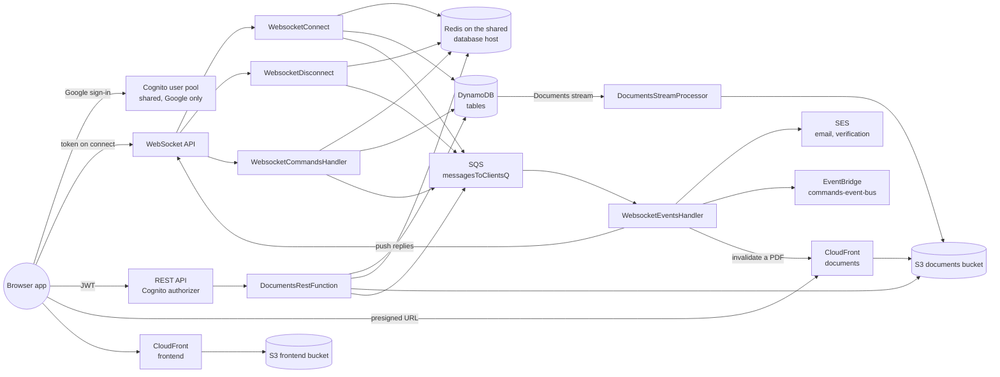

# Architecture

This document details the architecture the [README](../README.md) summarizes: every part the
stack deploys, how the parts talk, where the data lives and how the code is laid out. The local
setup and the deploy flow are in [Development & deployment](development.md).

**Contents:** [One body of code, several entry points](#one-body-of-code-several-entry-points) ·
[The entry points](#the-entry-points) · [Cross-cutting mechanisms](#cross-cutting-mechanisms) ·
[Storage](#storage) · [Codebase structure](#codebase-structure)

## One body of code, several entry points

Nothing in this app runs between requests. A browser command wakes a Lambda that reads or writes
a few DynamoDB items, and a change to an agreement wakes the Lambda that renders its PDF; then
both stop. One AWS SAM template, `scripts/template.yaml`, declares the whole stack
([ADR 0002](adr/0002-serverless-with-sam.md)).

## The entry points

- **Cognito** — the stack does not own a user pool. It adds an app client to the pool another
  stack of the account deploys, named by the `ExistingUserPoolId` parameter. The client allows
  only Google sign-in with the authorization code flow, and redirects to the frontend's
  CloudFront address (or the custom domain, when one is set) and to `http://localhost:3000`
  ([ADR 0004](adr/0004-google-sign-in-through-shared-user-pool.md)). [Sign-in](sign-in.md)
  details the flow and its setup in a new account.
- **WebSocket API** — selects the route by the `action` field of each message. `$connect` and
  `$disconnect` reach their own functions; `CommandsHandlerRouteKey` reaches the commands
  handler.
- **WebsocketConnect** (`backend/websockets/connections/connect.js`) — the browser passes its
  Cognito ID token in the connect URL. The function decodes the token and refuses an expired one;
  it does not check the token's signature. It records the connection and its user in Redis for
  one hour, and tells the other connected browsers who is online. It then decides the user's
  role: the admin when the user id equals the `AdminUserId` parameter, a landlord when a SaaS
  tenant record exists for the user and is not disabled, a renter otherwise. A landlord's first
  reply carries the apartments and the first apartment's activity. The reads have five seconds;
  past that the reply says the database did not answer.
- **WebsocketDisconnect** (`disconnect.js`) — removes the connection from Redis and sends the
  remaining browsers the updated list of who is online.
- **WebsocketCommandsHandler** (`websocketCommandsHandler.js`) — looks up the sender's user id
  in Redis by connection id, then runs one `create`, `read`, `update` or `delete` command on
  apartments, activity or SaaS tenants through the commands-handlers layer. The reply goes to
  every open connection of the same user.
- **messagesToClientsQ** — the SQS queue that carries every reply, email request, change event
  and cache invalidation to the events handler. A message that fails five times moves to
  `messagesToClientsDLQ`.
- **WebsocketEventsHandler** (`websocketEventsHandler.js`) — reads the queue in batches of ten.
  For each message it may push the reply to its target connections through the WebSocket
  management API, ask SES to verify the signed-in user's email address, send an email, publish
  the change to EventBridge, and invalidate one PDF in the documents CloudFront cache.
- **commands-event-bus** — an EventBridge bus that receives a `command-executed` event for every
  created, updated or deleted record. When the `TargetChattyLambdaArn` parameter names a
  function, a rule forwards to it an enabled apartment's update, a new activity entry waiting
  for confirmation, and a new enabled landlord; the deploy leaves the parameter empty, so no
  rule exists.
- **REST API** — every route requires a token the shared user pool issued:
  `POST /documents`, `GET /documents`, `GET`, `PUT` and `DELETE /documents/{documentId}`,
  `GET /documents/{documentId}/pdf`, and `POST /upload` for an attachment.
- **DocumentsRestFunction** (`backend/documents/documents.js`) — creates, lists, reads, updates
  and deletes rental agreements, stores uploaded attachments in S3, and answers with presigned
  URLs for the PDF and the attachments. Each create or update queues an email to the landlord
  and the first renter, and an update also queues the PDF's cache invalidation.
- **DocumentsStreamProcessor** (`documentsStreamProcessor.js`) — reads the Documents table's
  stream. A new or changed agreement fills the Hebrew Markdown template in
  `backend/documents/templates/` with the agreement's fields and both signature images, converts
  it to HTML with `marked`, prints it to PDF in headless Chromium and writes it to S3. A deleted
  agreement deletes its folder in the bucket.
- **Frontend bucket and distribution** — a public S3 website bucket behind CloudFront, which
  answers a missing path with `index.html` so the app's own routing handles it.
- **Documents bucket and distribution** — the agreements, signatures and attachments, served
  through their own CloudFront distribution (see Documents under
  [Cross-cutting mechanisms](#cross-cutting-mechanisms)).
- **Redis** — runs on the account's shared database host, outside this stack. The template takes
  its address and password as parameters, and every function that needs it connects to the
  host's public name with the password ([ADR 0003](adr/0003-redis-on-shared-database-host.md)).

## Cross-cutting mechanisms

- **Tenant isolation** — all landlords share the same functions and tables
  ([ADR 0001](adr/0001-shared-pool-multi-tenancy.md)). A landlord's `saas_tenant_id` is the
  landlord's Cognito user id, every item carries it, and the data layer's writes are conditional
  on it. An agreement is also changed by its renter: an update may set the agreement's
  `tenant_user_id` to a renter id the browser sends in the request body, and the write succeeds
  when the caller is the landlord, when no renter is recorded yet, or when the request names the
  recorded renter. The renter id is not compared with the caller's token.
- **Replies through the queue** — the functions behind the WebSocket API are deployed without the
  API's management address, so they never push to a browser themselves; every reply goes through
  the queue to the events handler. Email, EventBridge and CloudFront calls happen there too, out
  of the browser's request.
- **Cache-aside reads** — the data layer (`dbData.js`) reads the landlord's apartments, an
  apartment's activity, an apartment's agreements and a user's SaaS tenant record through Redis.
  A miss reads DynamoDB and stores the result for 24 hours under a key prefixed by the stack
  name; each write through the data layer deletes the keys it makes stale. The `DisableAppCache`
  parameter turns the cache off.
- **Shared code in layers** — the commands handlers, the data layer, the Redis client, the
  connections helpers and the document key helpers are Lambda layers the functions import from
  `/opt`. The deploy pins each layer to a version published once, so a change to a layer's
  source reaches the functions only through a new layer version (see
  [Development & deployment](development.md#layers)). The data layer imports from `/opt`
  inside Lambda and from `/usr/src/app/layers` elsewhere, so the container service under
  `backend/RenTracker-service/ecs/` runs the same code.
- **Documents** — an agreement's files live under `<saas_tenant_id>/<document_id>/` in the
  documents bucket: `rental-agreement.pdf`, the signature images and the attachments. The REST
  function signs an S3 URL valid for 24 hours and replaces its host with the documents
  distribution's, so the file is served through CloudFront. The distribution's cache key ignores
  the query string, so all signed URLs of one file share one cached copy, while CloudFront still
  forwards the signature to S3.
- **Email** — the events handler sends from one fixed sender address set in the template. Each
  WebSocket connect asks SES to verify the user's address unless it is verified already, since
  the SES sandbox sends only to verified addresses; the reply tells the browser when
  verification is pending.
- **Configuration** — `scripts/lib/stack-params.sh` passes every parameter the deploy controls,
  and the template hands them to the functions as environment variables. The frontend reads
  `frontend/src/appConfig.json`, which `scripts/lib/app-config.sh` writes from the stack's outputs.
- **Network** — the template can place the functions in a private subnet with a security group,
  but the deploy leaves both parameters empty, so the functions run outside any VPC and reach
  Redis and the AWS services over the internet.
- **Observability** — each function writes to a log group the template declares,
  `/aws/lambda/<stack>/<function>`, kept for 14 days. X-Ray tracing is on for every function and
  the REST API, and the functions annotate their traces with the stack name.
- **Nothing runs on a clock.** Every function starts from a request, a queue message or a table
  stream.

## Storage

The tables bill per request and carry the stack name in their table name. On the `main`
stack they are kept when the stack is deleted (`RetainResourcesOnDelete`); on `rntrk-fb` they
are deleted with it. Point-in-time recovery is on for every table except `SaaSTenants`.

| Table | Key | Indexes | Other attributes |
|-------|-----|---------|------------------|
| `SaaSTenants` | `saas_tenant_id` | — | `name`, `email`, `phone`, `address`, `israeli_id`, `is_disabled`, `created_at`, `updated_at` |
| `Apartments` | `apartment_id` | `SaaSTenantUpdatedIndex` (`saas_tenant_id`, `updated_at`) | `saas_tenant_id`, `address`, `is_housing_unit`, `unit_number`, `rooms_count`, `rent_amount`, `is_disabled`, `created_at`, `updated_at` |
| `Documents` | `document_id` | `ApartmentUpdatedIndex` (`apartment_id`, `updated_at`), `TenantUpdatedIndex` (`tenant_user_id`, `updated_at`) | `saas_tenant_id`, `apartment_id`, `tenant_user_id`, `template_name`, `template_fields`, `created_at`, `updated_at` |
| `ApartmentActivity` | `activity_id` | `ApartmentCreatedIndex` (`apartment_id`, `created_at`) | `saas_tenant_id`, `apartment_id`, `description`, `pending_confirmation`, `created_at` |

- `is_disabled` on a SaaS tenant record turns a landlord account off; the admin sets it.
- `template_fields` holds every field of the agreement form, including the signatures' names and
  the attachments' file names. The PDF's address is not stored; the REST function signs one on
  each request.
- `pending_confirmation`, when true, marks an activity entry that waits for the other side.

The **documents bucket** holds the files described under Documents above; objects move to the
Infrequent Access storage class after 30 days. The **frontend bucket** holds the built app. Both
buckets are deleted with the stack, and `aws-helper.sh --delete-stack` stops first while either
holds objects. **Redis** holds, under keys prefixed by the stack name, the cached reads and the
connection records: `conn:<connection id>` with the user's id, name and email, the set
`active_connections`, and `user:<user id>:connections`.

## Codebase structure

| Path | Contents |
|------|----------|
| `scripts/` | `template.yaml`, the deploy and operations scripts, and `lib/` with their shared helpers and settings files |
| `backend/websockets/connections/` | The WebSocket functions: connect, disconnect, commands handler, events handler |
| `backend/websockets/layers/connections/` | Source of the connections layer: who is online, and pushing to connections |
| `backend/RenTracker-service/ecs/layers/` | Sources of the commands-handlers, data and Redis client layers |
| `backend/RenTracker-service/ecs/` | A WebSocket server for a container, running the same layers; the template does not deploy it |
| `backend/documents/` | The REST function, the stream processor and the agreement templates |
| `backend/layers/document-utils/` | Source of the document-utils layer: the S3 key helpers |
| `backend/dbManagement/` | PostgreSQL schema scripts for the data layer's PostgreSQL module, which no function uses |
| `frontend/src/components/` | The React screens: apartments, activity, agreements, the agreement form, landlord settings |
| `frontend/src/redux/` | The Redux store, one folder per kind of data |
| `frontend/src/services/rest.ts` | The REST client for agreements and uploads |
| `frontend/src/locales/` | The Hebrew and English strings |
