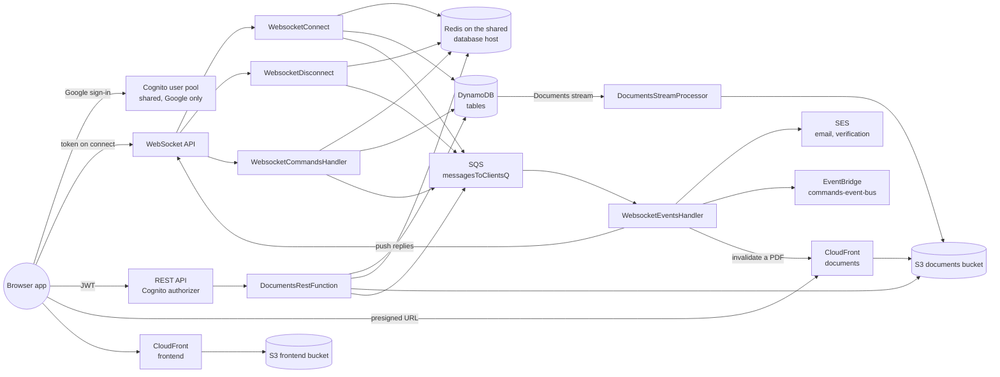

# Architecture

This document details the architecture the [README](../README.md) summarizes: every part the
stack deploys, how one deployment serves every landlord, where the data lives and how the code
is laid out. Each section is a summary that links the topic document holding the detail. The
local setup and the deploy flow are in [Development & deployment](development.md).

**Contents:** [One body of code, several entry points](#one-body-of-code-several-entry-points) ·
[The entry points](#the-entry-points) ·
[All landlords share one deployment](#all-landlords-share-one-deployment) ·
[Storage](#storage) · [Codebase structure](#codebase-structure)

## One body of code, several entry points

Nothing in this app runs between requests. A browser command wakes a Lambda that reads or writes
a few DynamoDB items, and a change to an agreement wakes the Lambda that renders its PDF; then
both stop. One AWS SAM template, `scripts/template.yaml`, declares the whole stack
(ADR 0002).

The commands handlers and the data layer are Lambda layers the functions share
([Shared code lives in layers](design-patterns.md#shared-code-lives-in-layers)),
so the functions import one body of code. The functions behind the WebSocket API never push to
a browser themselves
([Replies go through a queue](design-patterns.md#replies-go-through-a-queue)).

## The entry points

Each function writes to a log group the template declares, `/aws/lambda/<stack>/<function>`, kept
for 14 days. X-Ray tracing is on for every function and the REST API, and the functions annotate
their traces with the stack name.

**Entry points**, each route in [API endpoints](api.md):

- **WebSocket API** — carries every command on apartments, activity and SaaS tenants, routed by
  the `action` field of each message. `WebsocketConnect` reads the user from the Cognito ID
  token and decides the user's role; it and `WebsocketDisconnect` keep the connections in Redis.
  `WebsocketCommandsHandler` runs each command through the commands-handlers layer and replies
  to every open connection of the same user.
- **REST API** — one function, `DocumentsRestFunction`: behind the shared user pool's
  authorizer, the landlord's rental agreements, their PDFs, attachments and signing links; and
  two throttled routes with no sign-in, where a renter holding a link reads the agreement and
  signs (ADR 0005).

**Workers**, each one's steps, limits and retries in
[Workers' responsibilities and flows](workers.md):

- **`messagesToClientsQ`** feeds **`WebsocketEventsHandler`** — pushes each reply to its target
  connections, sends email, publishes each data change to `commands-event-bus`, an EventBridge
  bus, and invalidates a changed PDF in the documents CloudFront cache. `messagesToClientsDLQ`
  takes a message that keeps failing.
- **`DocumentsStreamProcessor`** — reads the Documents table's stream: it renders a new or
  changed agreement to a PDF in S3, writes the final copy once every renter has signed, and
  removes a deleted draft's files.

**Hosting and identity**

- **Frontend bucket and distribution** — a public S3 website bucket behind CloudFront, which
  answers a missing path with `index.html` so the app's own routing handles it.
- **Documents bucket and distribution** — the agreements, signatures and attachments, served
  through their own CloudFront distribution ([S3](data-model.md#s3)).
- **Cognito** — the stack does not own a user pool. It adds an app client to the pool another
  stack of the account deploys, named by the `ExistingUserPoolId` parameter, with Google as the
  only way to sign in ([Sign-in](sign-in.md),
  ADR 0004).

## All landlords share one deployment

One deployment serves every landlord: all landlords share the same functions and tables
(ADR 0001). A landlord's `saas_tenant_id` is the
landlord's Cognito user id, every item carries it, and the data layer's writes are conditional on
it. A renter, who does not sign in, changes an agreement only by signing through a link, whose
token names that one agreement.

## Storage

The records live in DynamoDB, the files in S3, and the cache and the connection records in
Redis. Every table, key, index and object layout is in [Data model](data-model.md).

- **DynamoDB**, six tables named after the stack:
  - `SaaSTenants` — one record per landlord account.
  - `Apartments` — a landlord's apartments.
  - `Documents` — the rental agreements, with a stream the PDF rendering reads.
  - `ApartmentActivity` — an apartment's activity entries.
  - `SigningLinks` — the links sent to renters, by the SHA-256 of their token, removed by TTL.
  - `SigningEvents` — every signature and paper import, only ever added to.
- **S3** — the documents bucket holds each agreement's PDF, its frozen and final copies,
  signature images and attachments under its landlord's prefix, and is kept with the tables when
  the `main` stack is deleted; the frontend bucket holds the built app.
- **Redis**, on the account's shared database host, outside this stack — the cached reads and
  the connection records (ADR 0003).

## Codebase structure

- `scripts/` — `template.yaml`, the deploy and operations scripts, and `lib/` with their shared
  helpers and settings files.
- `backend/websockets/connections/` — the WebSocket functions: connect, disconnect, commands
  handler, events handler.
- `backend/websockets/layers/connections/` — source of the connections layer: who is online,
  and pushing to connections.
- `backend/RenTracker-service/ecs/layers/` — sources of the commands-handlers, data and Redis
  client layers.
- `backend/RenTracker-service/ecs/` — a WebSocket server for a container, running the same
  layers; the template does not deploy it.
- `backend/documents/` — the REST function, the stream processor and the agreement templates.
- `backend/layers/document-utils/` — source of the document-utils layer: the S3 key helpers.
- `backend/dbManagement/` — PostgreSQL schema scripts for the data layer's PostgreSQL module,
  which no function uses.
- `frontend/src/components/` — the React screens: apartments, activity, agreements, the
  agreement form, landlord settings.
- `frontend/src/redux/` — the Redux store, one folder per kind of data.
- `frontend/src/services/rest.ts` — the REST client for agreements and uploads.
- `frontend/src/locales/` — the Hebrew and English strings.
