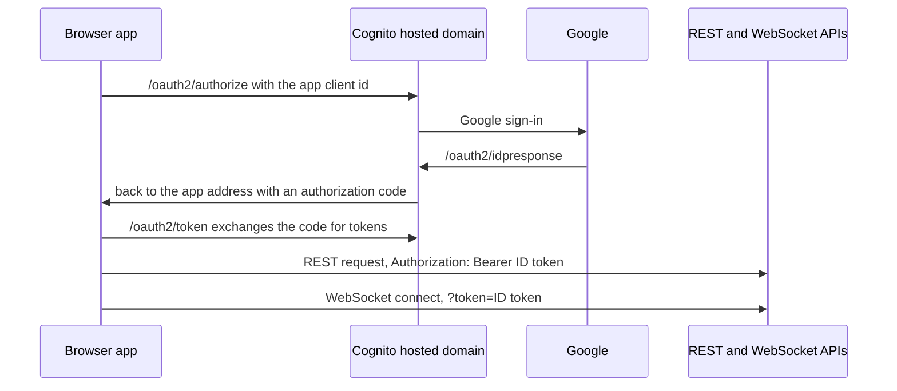

# Sign-in

Landlords, renters and the admin sign in to RENTracker with a Google account, and there is no
other way in. This page details the Cognito entry of
[Architecture](architecture.md#the-entry-points): how a sign-in reaches the APIs, what the
stack adds to the user pool it signs in through, and how to set it up in a new AWS account.
The pool is not this repo's: the `vsdb-cognito` stack of
the vpc-subnets-sgs repo owns it, together with its Google client, and several apps of the
account sign in through it (ADR 0004).

## How it works

1. The browser app signs in with `react-oidc-context` (`frontend/src/index.tsx`), configured
   from `frontend/src/appConfig.json`: the pool, the stack's app client and the redirect URL.
   The sign-in button sends the browser to the pool's hosted domain, which offers Google only;
   Google returns to the pool, and the pool returns the browser to the redirect URL with an
   authorization code, which the app exchanges for tokens. The app keeps the ID token, whose
   `sub` claim is the user id everywhere in the data.
2. The REST API's Cognito authorizer checks the ID token on every agreement request.
3. The WebSocket connect URL carries the ID token in its `token` parameter. The connect function
   reads it and refuses one without a user id or past its expiry.
4. Sign-out drops the tokens and sends the browser to the pool's `/logout` with the app client id
   and the sign-out URL, which ends the session at the hosted domain too.

The stack's app client, `UserPoolClient` in `scripts/template.yaml`, is all this repo adds to the
pool: the authorization code flow, Google as its only identity provider, and these two URLs as
both its callback and its sign-out URLs:

- `https://<distribution>.cloudfront.net`, the frontend distribution's address and the stack's
  `CloudFrontUrl` output (the custom domain instead, when the `CustomDomainName` and
  `CertificateArn` parameters are both set);
- `http://localhost:3000`, for `npm start` in `frontend/`.

Both are without a trailing slash. `deploy.sh` writes the matching one into `appConfig.json`: the
CloudFront address while it builds the published app, `http://localhost:3000` when it finishes,
so a local `npm start` signs in against the branch's stack. The CloudFront address is written
even when a custom domain is set.

## Setting up Google

A fresh account, with no Google Cloud project and no OAuth client yet, starts in the
vpc-subnets-sgs repo, before any step of this one: the Setting up Google section of
vpc-subnets-sgs's docs/sign-in.md walks from no Google project at all to a deployed shared pool.
The Google side belongs to that pool. Its OAuth client redirects only to the pool's hosted
domain, `https://vsdb-<account id>.auth.<region>.amazoncognito.com/oauth2/idpresponse`, never
to this app, so this repo holds no Google client id or secret, and nothing of this app is
entered in the Google Cloud console.

1. **Check for the pool.** Run `./scripts/aws-helper.sh --list-resources`; a deployed shared
   pool shows as `vsdb-cognito-UserPool` with its id and its `vsdb-<account id>` domain. The pool
   must be in this app's region, the region of `scripts/lib/aws-config.sh`, since the authorizer
   names the pool in the stack's own account and region. With the pool there, go to step 3.
2. **Without the pool, set up Google and the pool first.** Follow the Setting up Google section
   of vpc-subnets-sgs's docs/sign-in.md from its first step. It creates the Google Cloud project,
   its consent screen and OAuth client, stores the client id and secret in the Secrets Manager
   secret `/vsdb-cognito/google-secrets`, and deploys the pool with `./scripts/deploy.sh
   --cognito` from that repo's `main`, so the stack is `vsdb-cognito` and the domain prefix
   `vsdb`. Then run step 1 again for the pool's id.
3. **Name the pool.** In `stack_parameter_overrides` of `scripts/lib/stack-params.sh`, set
   `ExistingUserPoolId` to the pool's id from step 1. `ExistingCognitoDomain` derives itself as
   `vsdb-<account id>.auth.<region>.amazoncognito.com` and needs no edit for the shared pool. A
   different pool works too when it has a hosted domain, which then goes into
   `ExistingCognitoDomain`, and a Google identity provider named exactly `Google`.
4. **Deploy.** `./scripts/deploy.sh --frontend` creates the app client with the URLs above and
   prints the CloudFront address; sign in there or at `http://localhost:3000`.
5. **Make yourself the admin.** The admin is the user whose id equals the `AdminUserId`
   parameter, and its template default is a user of the original account's pool, so a new pool
   has no admin. Sign in once, then in the AWS console open **Amazon Cognito → User pools →
   vsdb-cognito-UserPool → Users**, open your user (named `google_<number>`) and copy its `sub`
   attribute. Add `"AdminUserId="` to `stack_parameter_overrides` and deploy again.

## Who may sign in

Google decides first: while the shared Google client's consent screen is in testing, only the
test users listed under **Audience → Test users** of that Google Cloud project get through, as
the vpc-subnets-sgs page describes. The shared pool runs no function before sign-up, so every
account Google lets through becomes a pool user on its first sign-in, and the app has no
allow-list of its own. What a user may do is the app's role decision: the `AdminUserId` user is
the admin, a user with an enabled SaaS tenant record is a landlord, and every other user is a
renter. A person who signs in to another app on the same pool
has the same user id here.
